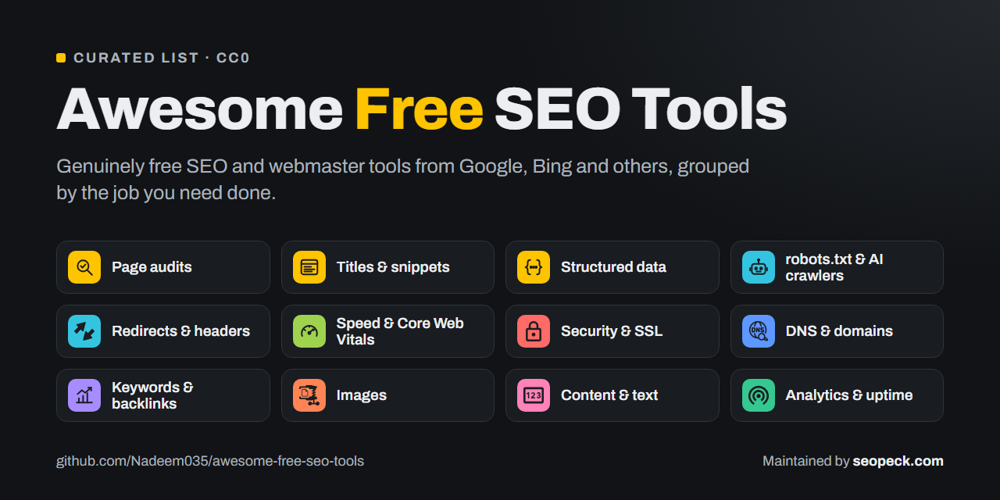

# Awesome Free SEO Tools

A curated list of **free** SEO and webmaster tools: things you can use without paying, grouped by the job you need done. Every entry is free to use (some have paid upgrades; the free part is what is listed).

> **Disclosure:** this list is maintained by [Nadeem Akram](https://seopeck.com/page/about-us), who also builds [SEOpeck](https://seopeck.com). SEOpeck tools are marked **(SEOpeck)** so you can tell them apart. Suggestions for other free tools are welcome; see [Contributing](#contributing).

## Contents

- [Search engine consoles](#search-engine-consoles)
- [Page audits and on-page SEO](#page-audits-and-on-page-seo)
- [Titles, descriptions and social previews](#titles-descriptions-and-social-previews)
- [Structured data](#structured-data)
- [Crawling, robots.txt and AI crawlers](#crawling-robotstxt-and-ai-crawlers)
- [Redirects, status codes and headers](#redirects-status-codes-and-headers)
- [Speed and Core Web Vitals](#speed-and-core-web-vitals)
- [Security and SSL](#security-and-ssl)
- [DNS and domains](#dns-and-domains)
- [Keyword research](#keyword-research)
- [Backlinks](#backlinks)
- [Content and text](#content-and-text)
- [Images](#images)
- [Analytics](#analytics)
- [Learning resources](#learning-resources)

## Search engine consoles

The first two tools every site should set up. They show how search engines see your site, straight from the source.

- [Google Search Console](https://search.google.com/search-console): search queries, clicks and impressions, indexing status, sitemaps, Core Web Vitals and manual actions for Google.
- [Bing Webmaster Tools](https://www.bing.com/webmasters): the same for Bing, whose index also feeds Copilot and other AI search tools. You can import your sites from Google Search Console.

## Page audits and on-page SEO

- [Google Lighthouse](https://developer.chrome.com/docs/lighthouse/overview): built into Chrome DevTools; audits performance, accessibility, best practices and basic SEO.
- [Screaming Frog SEO Spider](https://www.screamingfrog.co.uk/seo-spider/): desktop crawler for finding broken links, redirects, missing titles and duplicate content (free up to 500 URLs).
- [On-Page SEO Checker](https://seopeck.com/tool/seo-checker) **(SEOpeck)**: audits one URL's title, meta description, headings, image alt text, links, canonical, robots directives, Open Graph and JSON-LD, with a score and advice per check.
- [Word Density Counter](https://seopeck.com/tool/word-density-counter) **(SEOpeck)**: shows how often each word appears in a piece of text.
- [SEOpeck SEO Checker extension](https://chromewebstore.google.com/detail/seopeck-seo-checker-websi/pfnejidgfmndnhdibchdfplfjoohhcip) **(SEOpeck)**: Chrome and Edge extension that audits the page you are on: score and issue list, headings, schema, technologies and robots.txt.
- [Wappalyzer](https://www.wappalyzer.com/apps/): browser extension that shows the CMS, frameworks and other technologies a site uses (the extension is free).
- [CMS Detector](https://seopeck.com/tool/cms-detector) **(SEOpeck)**: shows which CMS, ecommerce platform, framework and analytics a website is built with, without installing anything.

## Titles, descriptions and social previews

- [SERP Snippet Preview](https://seopeck.com/tool/serp-preview) **(SEOpeck)**: previews a title and meta description as a Google result and measures their width in pixels, which is how Google truncates them.
- [SEO Tags Generator](https://seopeck.com/tool/seo-tags-generator) **(SEOpeck)**: generates title, meta description and Open Graph tags.
- [Twitter Card Generator](https://seopeck.com/tool/twitter-card-generator) **(SEOpeck)**: generates the meta tags for link previews on X.

## Structured data

- [Rich Results Test](https://search.google.com/test/rich-results): Google's test for whether a page's structured data is eligible for rich results.
- [Schema Markup Validator](https://validator.schema.org/): validates any schema.org markup (JSON-LD, Microdata, RDFa), not only the types Google uses.
- [Schema Markup Generator](https://seopeck.com/tool/schema-markup-generator) **(SEOpeck)**: builds JSON-LD for FAQ, Article, Organization, LocalBusiness and BreadcrumbList from a form.

## Crawling, robots.txt and AI crawlers

- [AI Crawler Checker](https://seopeck.com/tool/ai-crawler-checker) **(SEOpeck)**: reads a site's robots.txt and shows which AI crawlers (GPTBot, ClaudeBot, Google-Extended, PerplexityBot and more) are allowed or blocked.
- [ai-crawlers-robots-txt](https://github.com/Nadeem035/ai-crawlers-robots-txt): a maintained list of AI crawler user agents with ready-to-use robots.txt templates (same maintainer).
- [Robots.txt Generator](https://seopeck.com/tool/robotstxt-generator) **(SEOpeck)**: builds a robots.txt with per-crawler rules, crawl delay and a sitemap line.
- [llms.txt Checker](https://seopeck.com/tool/llms-txt-checker) **(SEOpeck)**: checks whether a site has an llms.txt file and whether it follows the format.
- [llmstxt.org](https://llmstxt.org/): the proposal that defines the llms.txt format.
- [XML-Sitemaps.com](https://www.xml-sitemaps.com/): generates an XML sitemap for small sites (free up to 500 pages).

## Redirects, status codes and headers

- [Redirect Checker](https://seopeck.com/tool/redirect-checker) **(SEOpeck)**: follows a URL's redirect chain hop by hop, with the status code and time of each step.
- [HTTP Status Code Checker](https://seopeck.com/tool/http-status-code-checker) **(SEOpeck)**: shows the status code a URL returns.
- [HTTP Headers Parser](https://seopeck.com/tool/http-headers-parser) **(SEOpeck)**: shows every response header, including caching and security headers.
- [.htaccess Redirect Generator](https://seopeck.com/tool/htaccess-generator) **(SEOpeck)**: writes Apache redirect rules.
- [MDN: HTTP response status codes](https://developer.mozilla.org/en-US/docs/Web/HTTP/Reference/Status): the reference for what each code means.

## Speed and Core Web Vitals

- [PageSpeed Insights](https://pagespeed.web.dev/): Google's lab test plus real-user Core Web Vitals data for any URL.
- [WebPageTest](https://www.webpagetest.org/): detailed waterfall tests from different locations, browsers and connection speeds.
- [GZIP Compression Test](https://seopeck.com/tool/gzip-test) **(SEOpeck)**: checks whether a server compresses its responses.
- [Web Vitals on web.dev](https://web.dev/articles/vitals): what LCP, INP and CLS measure and what good scores are.

## Security and SSL

- [SSL Labs Server Test](https://www.ssllabs.com/ssltest/): in-depth grade of a server's TLS configuration.
- [Security Headers](https://securityheaders.com/): grades a site's HTTP security headers.
- [SSL Checker](https://seopeck.com/tool/ssl-checker) **(SEOpeck)**: quick check of a certificate's issuer, domain and expiry date.

## DNS and domains

- [DNS Lookup](https://seopeck.com/tool/dns-lookup) **(SEOpeck)**: A, AAAA, MX, TXT and CNAME records for a domain.
- [MX Lookup](https://seopeck.com/tool/mx-lookup) **(SEOpeck)**: the mail servers for a domain, in priority order.
- [Domain WHOIS](https://seopeck.com/tool/domain-whois) **(SEOpeck)**: registrar and expiry date of a domain.
- [Website Status Checker](https://seopeck.com/tool/website-status-checker) **(SEOpeck)**: is a site down for everyone or just for you.
- [SPF, DKIM & DMARC Checker](https://seopeck.com/tool/spf-dkim-dmarc-checker) **(SEOpeck)**: checks a domain's email authentication records and explains what is missing.
- [MxToolbox SuperTool](https://mxtoolbox.com/SuperTool.aspx): DNS, MX, blacklist and email-health lookups in one place.

## Keyword research

- [Google Trends](https://trends.google.com/): relative search interest over time and by region, and rising related queries.
- [Google Keyword Planner](https://business.google.com/en-all/ad-tools/keyword-planner/): search volume ranges and keyword ideas (free with a Google Ads account; no ad spend needed).
- Google Search Console's Performance report is the best free keyword tool for an existing site: it shows the real queries you already appear for.

## Backlinks

- [Ahrefs Webmaster Tools](https://ahrefs.com/webmaster-tools): free backlink and site audit data for sites you can verify you own.
- Google Search Console's Links report lists the sites that link to you most.
- Bing Webmaster Tools has a free Backlinks report too, and lets you compare your links with other domains.

## Content and text

- [Word Count](https://seopeck.com/tool/word-count) **(SEOpeck)**: word and character counts as you type.
- [Text to Slug](https://seopeck.com/tool/text-to-slug) **(SEOpeck)**: turns a title into a clean URL slug.

## Images

- [Image Compressor](https://seopeck.com/tool/image-compressor) **(SEOpeck)**: compresses images in the browser with a quality slider and a before/after size comparison.

## Analytics

- [Google Analytics](https://analytics.google.com/): traffic, sources and engagement.
- [Vaneform](https://vaneform.com/): look up monthly visitors, traffic trends and visitor sources for any website, for free.

## Learning resources

- [Google Search Central documentation](https://developers.google.com/search/docs): Google's own guidance on crawling, indexing, ranking and structured data.
- [Bing Webmaster Guidelines](https://www.bing.com/webmasters/help/webmaster-guidelines-30fba23a): Bing's equivalent.
- [SEOpeck blog](https://seopeck.com/blog) **(SEOpeck)**: plain-language guides, such as the [on-page SEO checklist](https://seopeck.com/blog/on-page-seo-checklist) and [how to write title tags and meta descriptions](https://seopeck.com/blog/how-to-write-title-tags-and-meta-descriptions).

## Contributing

Know a genuinely free SEO tool that belongs here? Open a pull request or an issue. Rules:

1. The tool must be **free to use** for its core job, without a trial that expires.
2. One line per tool: link, then what it does, in plain words. No marketing language.
3. Put it in the section that matches the job it does.
4. Paid-only tools, link-selling services and "instant backlinks" products are not accepted.

## License

[CC0 1.0](LICENSE): public domain.
